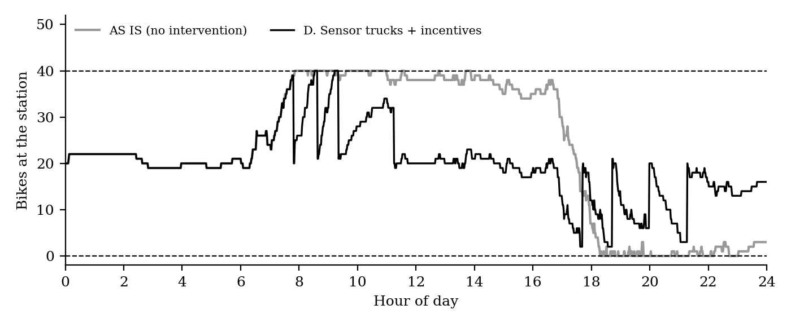
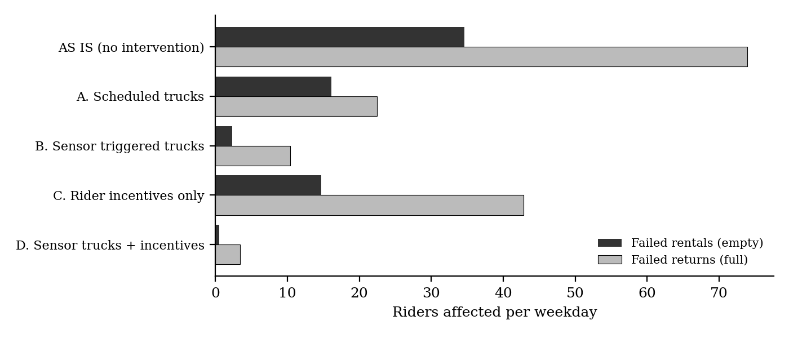
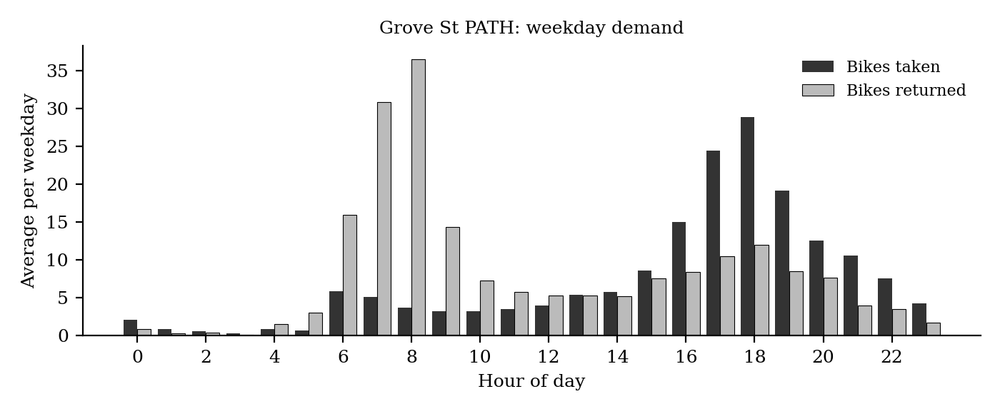
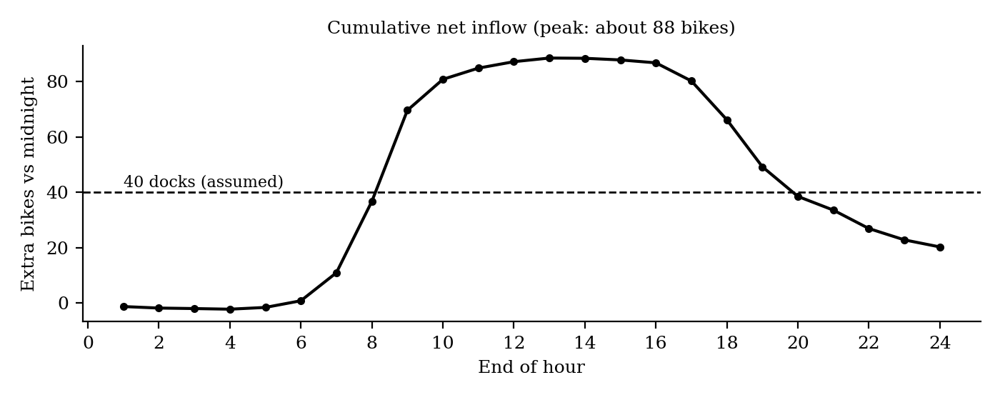
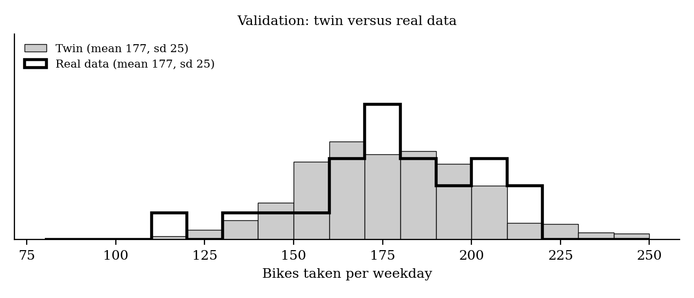
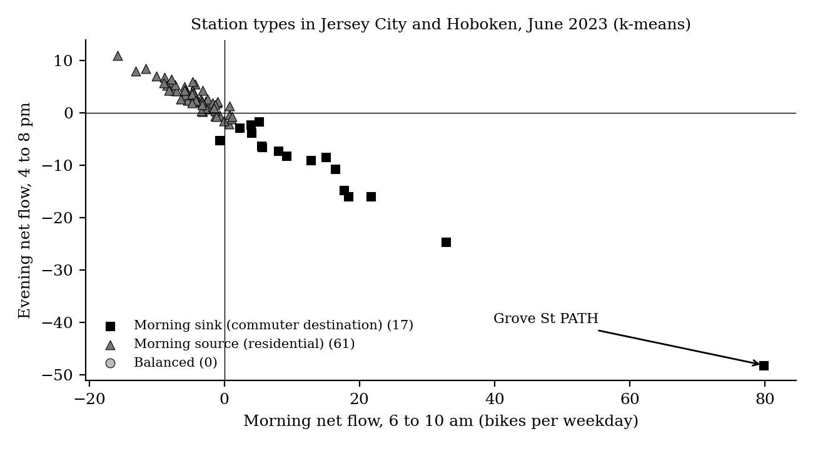
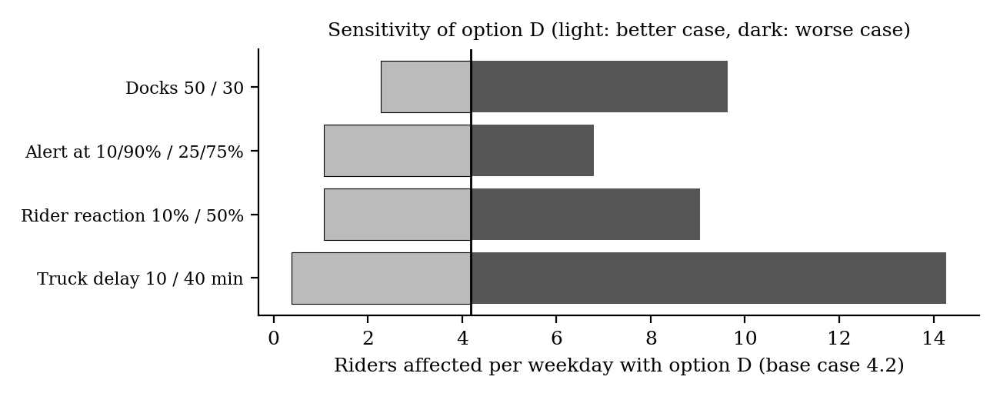

# Citi Bike Station Digital Twin

A data driven digital twin of a real bike share station, built from Citi Bike's public trip history and used to test rebalancing policies before trying them on real riders.

**Key result:** at Grove St PATH, the busiest station in Jersey City and Hoboken, combining sensor triggered trucks with rider incentives cuts the number of riders who face an empty or full station from about **108 to about 4 per weekday (minus 96 percent)**, with fewer truck visits than trucks alone.



## Why this project

Bike share riders do not move bikes evenly. In the morning, commuters ride to train stations and fill them up; in the evening, they empty them. When a station is empty you cannot rent a bike, and when it is full you cannot return one. Operators fix this by moving bikes with trucks, valets and rider incentives. This project asks a simple question: **which rebalancing policy works best, and how can we know before changing anything in the real world?**

## What the project does

1. **Analyses real data:** 97,023 trips from June 2023 (Jersey City and Hoboken, 144 stations).
2. **Learns demand** at one station for every hour of a weekday.
3. **Simulates the station minute by minute** with a limited number of docks.
4. **Validates the twin:** simulated daily demand matches the real data (mean 177 bikes per weekday, spread of about 25, in both).
5. **Tests five policies** and compares them on the same KPIs.

## Results (40 docks, 500 simulated weekdays per policy)

| Policy | Failed rentals/day | Failed returns/day | Truck visits/day | Bikes moved/day |
|---|---|---|---|---|
| No intervention | 34.6 | 73.9 | 0 | 0 |
| A. Scheduled trucks | 16.1 | 22.5 | 4.0 | 86.6 |
| B. Sensor triggered trucks | 2.3 | 10.4 | 7.8 | 136.9 |
| C. Rider incentives only | 14.7 | 42.8 | 0 | 0 |
| **D. Sensor trucks + incentives** | **0.5** | **3.4** | **7.2** | **119.3** |



Option D stays the best with 30 and 50 docks too (see `results/sensitivity.csv`).

### The demand pattern behind the problem




### Validation



## Deeper analysis

`scripts/deep_analysis.py` extends the study (it also needs the January 2023 file, see `data/README.md`):

- **Whole network:** 78 busy stations clustered with k-means into commuter destinations (17) and residential stations (61). Only 6 stations swing by more than 20 bikes a day; Grove St PATH swings by about 90.
- **Seasons:** the morning wave at Grove St PATH still reaches about 62 extra bikes in January.
- **Operator benchmark:** without rebalancing, the station is empty or full 39 percent of the time between 6 am and midnight, against a 3 percent service level used in the New York contract. Only the live data policies (B and D) meet it; D reaches 1.0 percent.
- **Confidence intervals:** option D affects 3.6 to 4.3 riders per weekday (95 percent CI), with no overlap with any other option.
- **Sensitivity:** truck response time is the assumption that matters most.




## How it works

The twin (`citibike_twin/simulation.py`) runs 1,440 one minute steps per simulated day:

- **Demand:** each minute, the number of riders who want a bike and the number who want to return one are drawn from a Poisson distribution whose average comes from the real hourly data.
- **Day to day variation:** each day gets a random busy or quiet factor (lognormal, mean 1), calibrated so the spread of simulated days matches the real spread.
- **Physical limits:** no rental when the station is empty, no return when it is full; each case is counted as a failure.
- **Policies:** scheduled trucks, trucks triggered when the station passes a fill threshold, and incentives that send a share of riders to a nearby station when this one is nearly full or empty.

## System analysis

The project follows the system development lifecycle. The `docs/diagrams/` folder contains the models of the current system and of the redesign:

| Current system (AS IS) | Redesigned system (TO BE) |
|---|---|
| [Context diagram](docs/diagrams/1_context_diagram.png) | [Swimlane with sensor trucks and incentives](docs/diagrams/6_swimlane_to_be.png) |
| [Level 1 DFD](docs/diagrams/2_level1_dfd.png) | [Architecture](docs/diagrams/7_architecture_to_be.png) |
| [Use case diagram](docs/diagrams/3_use_case.png) | |
| [Swimlane](docs/diagrams/4_swimlane_as_is.png) | |
| [ERD in Chen notation](docs/diagrams/5_erd_chen.png) | |

## Project structure

```
citibike_twin/        the Python package
  data.py             load trips, hourly demand, daily demand, system summary
  simulation.py       the minute by minute station simulation and the Policy settings
  policies.py         the baseline and the four redesign options
  metrics.py          turns daily results into KPIs and confidence intervals
  network.py          station level imbalance and k-means station types
  plots.py            black and white charts
scripts/run_analysis.py   runs everything and writes results/ and figures/
app/streamlit_app.py      interactive dashboard
notebooks/analysis.ipynb  step by step walkthrough
tests/                    unit tests (pytest)
docs/diagrams/            system analysis diagrams (DFDs, use case, swimlanes, Chen ERD, architecture)
```

## Run it

```bash
pip install -r requirements.txt
# download the data file first, see data/README.md
python scripts/run_analysis.py --data data/JC-202306-citibike-tripdata.csv
streamlit run app/streamlit_app.py
pytest
```

## Assumptions and limitations

- **Number of docks:** 40 is an assumption (the trip files do not include station capacity); results are tested at 30 and 50.
- **Policy parameters:** the 20 minute truck delay, the 15 and 85 percent thresholds and the 30 percent rider reaction are design assumptions that a pilot would need to measure.
- **Observed demand only:** riders who gave up because a station was empty or full are not in the data, so real demand may be slightly higher.
- **One station, one month:** a network model and other seasons are the next steps.

## Next steps

- Network model where bikes removed from one station feed nearby stations.
- Forecasting demand from weather and calendar data.
- Calibrating the station capacity and status with Citi Bike's live station feed.

## Data

Citi Bike trip history, published by Citi Bike at https://citibikenyc.com/system-data. The raw files are not included in this repository; see `data/README.md`. Please check Citi Bike's data license on that page before reusing the data.

## Background

This project started as my Honors work for BAI 3399 System Analysis and Design at Al Akhawayn University (Fall 2026), where I modelled the current system, built the twin, and redesigned the rebalancing process.

**Author:** Kamar Maroihi

Copyright © 2026 Kamar Maroihi. All rights reserved. No part of this work may be copied or reused without permission.
